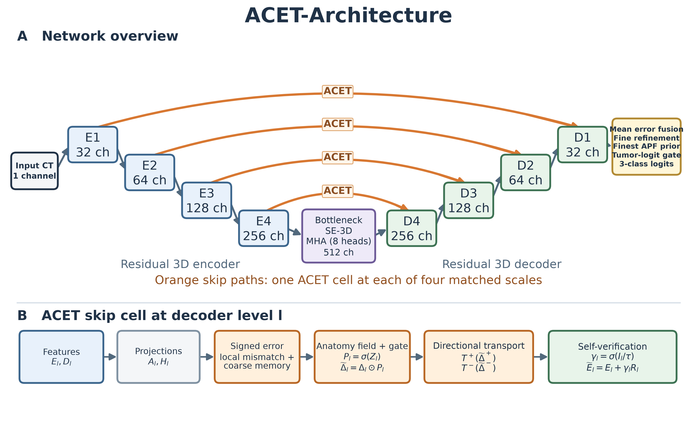
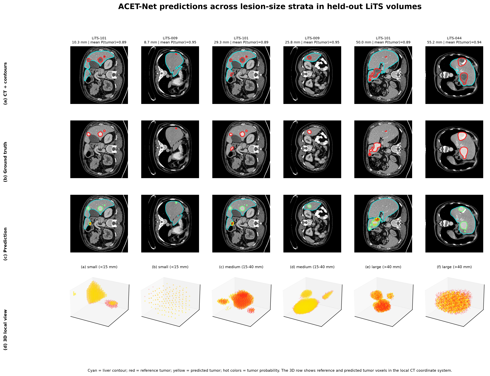
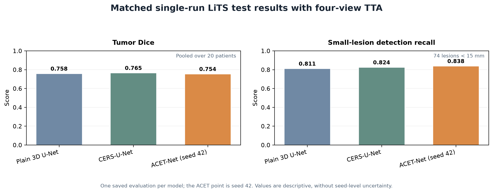
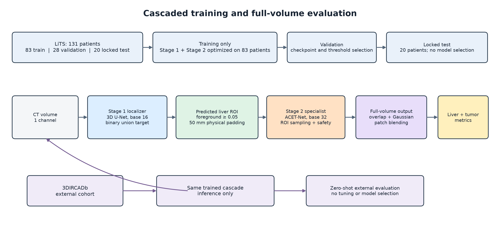

# ACET-Net: Anatomy-Conditioned Error Transport for 3D Liver Tumor Segmentation

ACET-Net is a 3D segmentation model for CT that predicts background, liver, and tumor labels together. Its central idea is to make decoder skip-connection corrections depend on the model's own estimate of whether a voxel belongs to the liver. This focuses fine-scale error correction on anatomically plausible tissue and aims to reduce false positive tumor predictions outside the liver.

> Research code and an experimental checkpoint. This is not a clinically validated or regulatory-cleared medical device. Do not use it to make clinical decisions.



## What is included

- `src/`: training, model, preprocessing, whole-volume evaluation, ROI generation, and optional external-evaluation modules.
- `models/acet_net_seed42_best.pt`: selected ACET-Net Stage 2 checkpoint.
- `models/liver_localizer_unet_seed42_best.pt`: Stage 1 binary liver-plus-tumor localizer checkpoint for the optional ROI workflow.
- `results/lits_test_summary.json`: aggregate held-out LiTS test metrics without patient identifiers or lesion coordinates.
- `results/*config_sanitized.json`: run settings with machine-specific data paths, Drive identifiers, and ROI paths removed.
- `assets/`: architecture, qualitative prediction, and two-stage workflow figures used below.

Model checkpoints are tracked with Git LFS. Install Git LFS before cloning or downloading model files. If LFS is unavailable or quota is exhausted, the source and results remain usable, but checkpoint downloads may return small pointer files instead of weights.

## Method

At each decoder scale, ACET compares sigmoid-projected encoder evidence with the decoder hypothesis to form a signed disagreement signal. A decoder feature head predicts a soft liver plausibility field. The disagreement is multiplied by this field before being transformed into a candidate skip update. A learned self-verification gate then scales the update according to whether it reduces disagreement. The finest liver plausibility field is also reused as a bounded tumor-logit prior.

The model uses a 3D residual encoder-decoder with SE and transformer context at the bottleneck, multi-scale supervision, and overlapping-patch volume inference with Gaussian blending. The implementation also provides `unet` and `cers` architecture choices for comparison; their checkpoints are not included in this compact release.



## Data and evaluation protocol

Training is intended for the LiTS cohort only. The pipeline enforces 131 paired LiTS cases and a patient-level split of 83 train, 28 validation, and 20 held-out test patients using split seed 42. The test split is excluded from training cache construction and checkpoint selection. Labels are `0 = background`, `1 = liver`, and `2 = tumor`.

3DIRCADb is supported only as a separate external evaluation through `src.prepare_ircadb` and `src.evaluate_ircadb`; it must not be used for training, model selection, or threshold tuning. Dataset files, preprocessed caches, patient-specific prediction volumes, and per-lesion coordinates are not included. Obtain datasets from their official sources and follow their terms of use.

### Reported held-out LiTS result

The included summary reports four-view in-plane flip test-time augmentation (TTA enabled) on 20 held-out volumes. Metrics are aggregate overlap/classification measures from this project's evaluation code. Lesion detection recall is reported separately by component size and should not be confused with voxel-wise tumor recall.

| Metric | Result |
| --- | ---: |
| Liver Dice | 0.9514 |
| Liver precision | 0.9226 |
| Liver recall | 0.9821 |
| Tumor Dice | 0.7537 |
| Tumor precision | 0.7571 |
| Tumor recall | 0.7503 |
| Tumor IoU | 0.6047 |
| Small-lesion detection recall (<15 mm) | 0.8378 (62/74) |
| Medium-lesion detection recall (15–40 mm) | 0.9583 (23/24) |
| Large-lesion detection recall (>40 mm) | 0.8333 (5/6) |

These are results from one seed and one held-out split. They are not a multi-seed estimate, and comparisons to other papers are not claimed unless preprocessing, split, inference, and metric definitions are matched. For definitions and complete aggregate values, see `results/lits_test_summary.json`.



## Additional experiment results

The `results/` directory contains the aggregate LiTS comparison results for CERS-U-Net and plain 3D U-Net, each with and without four-view flip TTA; all available zero-shot 3DIRCADb summaries for the ACET, CERS, and U-Net runs; and validation threshold-sweep outputs. The `results/ablations/` folder includes the full 18-epoch aggregate train/validation histories and selected/final validation summaries for the anatomy-gating-off, transformer-off, and self-verification-off ablations. No held-out test metrics were available for those ablations, so they are explicitly labeled as validation-only. See [the results index](results/README.md) for provenance and interpretation notes.

## Optional two-stage ROI workflow

The Stage 1 U-Net predicts the foreground union (`label >= 1`) to suggest liver-region boxes. The Stage 2 ACET model remains the final three-class segmenter. ROI sampling is a training focus mechanism; whole-volume evaluation reconstructs complete volumes and retains a safety sampling path. The ROI manifest is dataset-specific and is intentionally not distributed.



For Stage 1 architecture and data-boundary rationale, see `src/train.py` and the Stage 1 settings in `results/liver_localizer_seed42_config_sanitized.json`.

## Setup

The project was developed with Python 3.14 and PyTorch 2.11.0 with CUDA 12.8 on Windows. `requirements.txt` configures the CUDA PyTorch package index. Use a compatible NVIDIA driver and install the matching CUDA-enabled PyTorch build; avoid replacing it with a CPU-only wheel. On Windows, keep DataLoader workers at 0.

```powershell
py -3.14 -m venv .venv
.\.venv\Scripts\Activate.ps1
python -m pip install --upgrade pip
python -m pip install -r requirements.txt
```

Put the LiTS images and labels under `dataset/Lits` in the directory structure expected by `src.data`, then run commands from the repository root. The preprocessing cache is generated locally and is not part of this repository.

## Evaluate the included ACET checkpoint

The evaluator reconstructs full volumes from overlapping patches. Point `--run` to a run directory containing `config.json` and a `checkpoints` subdirectory. For a clean setup, create a run folder and place the included checkpoint at `runs/acet_final/checkpoints/best.pt`; supply the LiTS data root explicitly:

```powershell
New-Item -ItemType Directory -Force runs\acet_final\checkpoints | Out-Null
Copy-Item models\acet_net_seed42_best.pt runs\acet_final\checkpoints\best.pt
Copy-Item results\acet_net_seed42_config_sanitized.json runs\acet_final\config.json
.\.venv\Scripts\python.exe -m src.evaluate `
  --run runs\acet_final `
  --split test `
  --checkpoint best.pt `
  --data-root dataset\Lits
```

Use a correctly populated LiTS root with exactly 131 image/label pairs; this is an enforced project requirement. Optional four-view flip TTA is enabled with `--tta` and is a separate evaluation condition. Any probability threshold must be selected using validation data before a locked test evaluation.

## Training

Canonical commands and resume behavior are described in `src/train.py` argument help and the sanitized model configuration. A representative Stage 2 configuration uses `--architecture acet --base-channels 32 --patch-depth 32 --patch-height 128 --patch-width 128 --batch-size 2 --workers 0 --seed 42`. Training requires the LiTS dataset and substantial GPU memory; start with the configuration appropriate to your hardware. The exact settings for the included model are recorded in `results/acet_net_seed42_config_sanitized.json`.

To run the two-stage workflow, train Stage 1 with `--architecture unet --base-channels 16 --stage1`, generate a local ROI manifest with `src.generate_rois`, then pass that manifest to Stage 2 with `--architecture acet --base-channels 32 --roi-manifest <manifest>`. Do not use ACET as Stage 1: its anatomy-conditioned transport depends on a liver plausibility estimate.

## Repository layout

```text
src/       Python implementation
models/    selected Stage 1 and Stage 2 checkpoints (Git LFS)
results/   aggregate results and sanitized run configurations
assets/    figures referenced in this README
```

## Citation

If you use this code, please cite the associated project/paper once a formal bibliographic record is available. No peer-reviewed publication details are asserted in this repository yet.

## License

No license is included yet. Unless a license is added by the repository owner, standard copyright applies and reuse permissions are not granted. LiTS and 3DIRCADb data are not redistributed here and remain subject to their respective terms.
